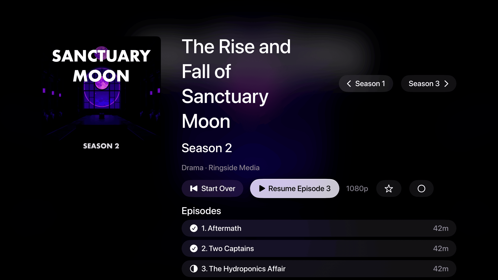
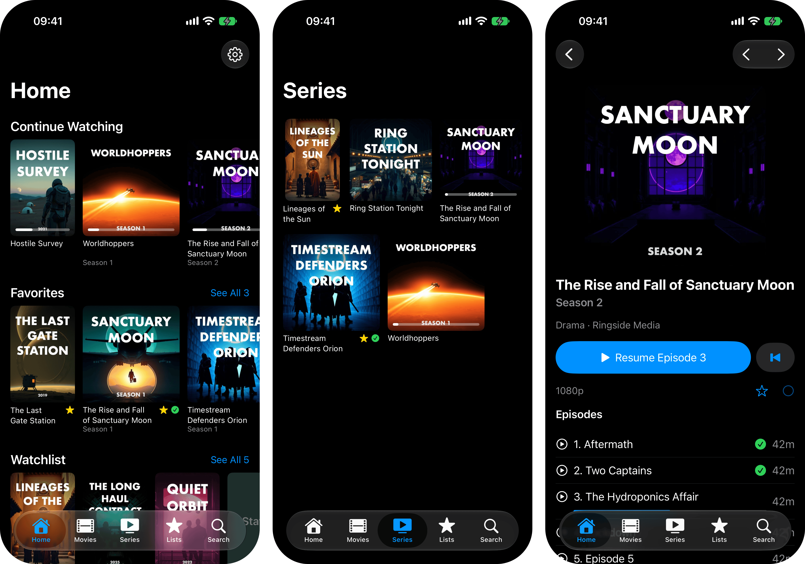
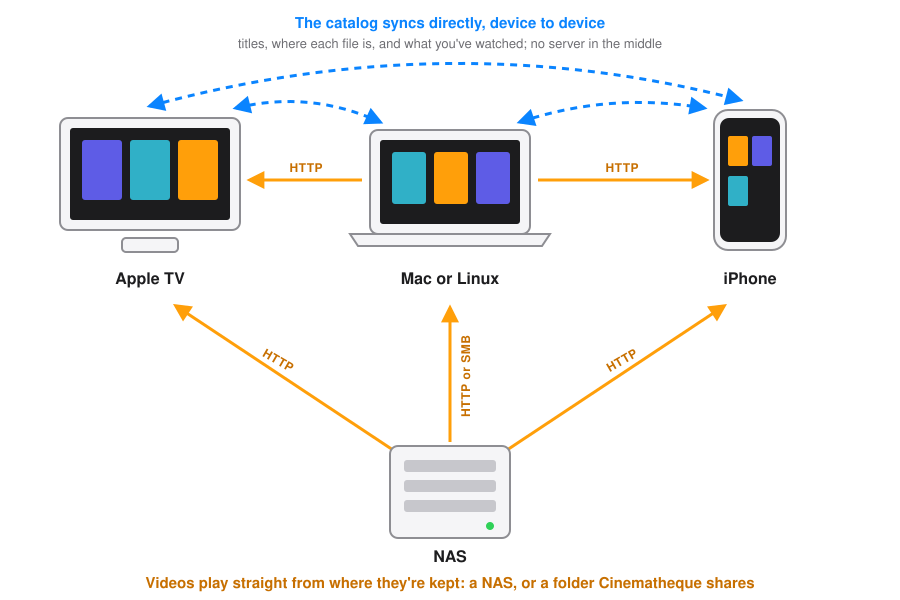

# Cinematheque

Cinematheque is a video library for your household. It catalogs the movies and TV shows on your own disks and NAS, and plays them on your devices straight from where they're kept. There's nothing to subscribe to or buy, and no account: the catalog is shared directly among your devices, and with the family and friends you invite.

> **Status:** early, at version 0.1 (see [Status](#status)).

<table><tr>
<td align="center"><a href="docs/screenshots/mac-dark.png"><picture><source media="(prefers-color-scheme: light)" srcset="docs/screenshots/mac-light.png"></picture></a><br><sub>Mac</sub></td>
<td align="center"><a href="docs/screenshots/tv-dark.png"><picture><source media="(prefers-color-scheme: light)" srcset="docs/screenshots/tv-light.png"></picture></a><br><sub>Apple TV</sub></td>
<td align="center"><a href="docs/screenshots/iphone-dark.png"><picture><source media="(prefers-color-scheme: light)" srcset="docs/screenshots/iphone-light.png"></picture></a><br><sub>iPhone (a prototype)</sub></td>
<td align="center"><a href="docs/screenshots/web-dark.png"><picture><source media="(prefers-color-scheme: light)" srcset="docs/screenshots/web-light.png"></picture></a><br><sub>Web</sub></td>
</tr></table>

<sub>Shown on a made-up library.</sub>

## Status

Early, at version 0.1: expect rough edges, and changes between versions.

| | State |
| --- | --- |
| **Mac** (macOS 15+) | Released, not yet notarized: browsing, playing, lists, downloads, and Settings for sources, people, and devices |
| **Apple TV** (tvOS 18+) | Browsing, playing, lists, and Settings for people, devices, and servers; not released yet, so build it with Xcode |
| **iPhone** (iOS 18+) | A prototype: browsing, playing, and lists; nothing adds sources, pairs devices, or downloads yet |
| **Web client** | In the command-line app (`serve --web`), for any browser on your network |
| **Command-line app** | Released, for macOS and Linux |
| **Linux and Windows players** | Planned |

Planned beyond them: metadata from outside your files, a transcoder, and a list's own order; see [DEVELOPMENT.md](DEVELOPMENT.md).

## How it works

Every device keeps its own copy of the catalog, and of what you've watched, but not the videos. So each one browses offline, and catches up with the others when it can reach them.

<p align="center"></p>

* **Library:** the catalog: movies and series, their episodes and versions, and where each file is.
* **Source:** a folder or server holding your videos. Cinematheque only reads it, and never changes its files.
* **Quality:** one encoding of a title, such as 1080p or 4K HDR. A quality may have copies on several sources; when one doesn't load, players try the next.
* **Device:** anything running Cinematheque. Devices sync directly with each other, with no server in the middle.

## Getting it

* **The Mac app** and **the command-line app** (for macOS and Linux) are on the [releases page](https://github.com/idiomatic/Cinematheque/releases), with what changed in each ([CHANGELOG.md](CHANGELOG.md)).
* **The Apple TV and iPhone apps** aren't released yet; build them with Xcode (see [For developers](#for-developers)).
* **Without a screen,** on a home server or a NAS that runs Linux, the command-line app builds and shares a library, and can offer it to browsers (see the [guide](docs/guide.md#in-a-browser) and [cli/README.md](cli/README.md)).

### Opening a download

Check a download against its `.sha256` file:

* macOS: `shasum -a 256 -c FILE.sha256`
* Linux: `sha256sum -c FILE.sha256`

Releases aren't notarized yet, so macOS stops them the first time:

* **The Mac app:**
  1. Unzip it, move Cinematheque.app to Applications, and open it.
  2. When macOS says it can't check it for malicious software, choose Done.
  3. In System Settings › Privacy & Security, under Security, choose Open Anyway beside Cinematheque, and confirm with your password.

  Or clear the download's mark in Terminal, then open it as usual:

  ```sh
  xattr -dr com.apple.quarantine /Applications/Cinematheque.app
  ```

* **The command-line app on macOS:** clear the mark a browser's download leaves, then run it:

  ```sh
  tar -xzf cinematheque-*.tar.gz
  xattr -d com.apple.quarantine cinematheque
  ./cinematheque --version
  ```

* **The command-line app on Linux:** it needs SQLite and Avahi's library for DNS-SD, with Avahi's daemon running:
  * Alpine: `apk add sqlite-libs avahi-compat-libdns_sd`
  * Fedora: `dnf install sqlite-libs avahi-compat-libdns_sd`
  * Debian, Ubuntu: `apt install libsqlite3-0 libavahi-compat-libdnssd1`

When either app first reaches your network, macOS asks to let it find devices on your local network. Allow it, or it can't reach your NAS or your other devices (System Settings › Privacy & Security › Local Network changes it later).

## Getting started

1. On first run, an app creates a library, or joins one by a code it shows (see [Sharing a library](#sharing-a-library)).
2. Add a source, a folder or server of your videos (below). The library fills in as it looks through it.

The Mac's Settings manage sources, people, and devices, so a household needs no command line. On a Mac, the app and the command-line app share one library, so either can manage it.

### In a browser, quickly

On a computer that stays on (a Linux server, a NAS that runs Linux, or a Mac), the command-line app starts a library, shares a folder of videos, and offers both to every browser on your network:

```sh
cinematheque library create
cinematheque serve --web --media /srv/videos &
cinematheque source add http://hal.local:8008/media/
cinematheque crawl
```

Then open `http://hal.local:8008/` in a browser, by the computer's `.local` name or its address. Anyone who can reach the port can use it, so the web client is off unless you give `--web`. To serve a library you already have instead, pair the computer as one of your devices (`cinematheque person pair`) rather than creating one; the [guide](docs/guide.md#in-a-browser) has that, keeping it running, and what browsers play.

## Preparing a source

A source is a folder of videos your devices can reach over your network. The easiest is one you already have, as it is: Cinematheque never changes its files.

### A folder

* **On a Mac,** choose Add Folder… in Settings › Sources: a folder on the Mac, on a drive plugged into it, or on a NAS share mounted in Finder. While the app runs, it shares the folder with your other devices, which play from it.
* **Anywhere else,** on macOS or Linux, the command-line app shares a folder, then adds it:

  ```sh
  cinematheque serve --media /srv/videos
  cinematheque source add http://hal.local:8008/media/
  ```

### A web server

If your videos are on a server that already serves files, such as a NAS's web server, Caddy, nginx, or Apache, add its address instead (Add Server… on the Mac).

* **Seeking:** any server that lists its folders will do if players can seek within a file, as nearly all can. Python's built-in `http.server` can't: its videos are listed, but won't play.
* **No listings?** Put a file named `INDEX` in the served folder, listing its files, and remake it whenever they change:

  ```sh
  find . -type f ! -name INDEX > INDEX
  ```

  It works on Linux, macOS, BSD, and most NAS shells. An `INDEX` is also the fastest way to read a large source; the command-line app's server makes one for you.

### Naming

Cinematheque understands the naming conventions of Plex, Jellyfin, and Kodi, and common download names. Titles are recognized best with the year, and series by their folders:

```
Movies/All Systems Red (2017).mkv
Movies/All Systems Red (2017) - Director's Cut.mkv
Movies/Network Effect (2020) {tmdb-12345}/Network Effect (2020).mkv
TV Shows/Worldhoppers/Worldhoppers 102 The Wormhole.m4v
TV Shows/Sanctuary Moon (2019)/Season 01/Sanctuary Moon - S01E01 - Pilot.mkv
TV Shows/Worldhoppers/Worldhoppers The Lost Signal.m4v
```

Dated videos, as a channel's archive has them, are a series of a season a year and an episode a day:

```
Channels/Feed Watch/Feed Watch 2024-03-12 The Wormhole Explained [youtube-ID].mp4
```

The [guide](docs/guide.md#naming) covers specials, yt-dlp's names, and tidying names that don't agree.

### Quality

A file's quality comes from its name (its resolution, origin, codec, and dynamic range), so a title's qualities can sit side by side, and the apps' Quality picker chooses which to play:

```
Movies/All Systems Red (2017)/All Systems Red (2017) - 1080p.mkv
Movies/All Systems Red (2017)/All Systems Red (2017) - 4K HDR.mkv
Movies/Network.Effect.2020.1080p.BluRay.x264-GROUP.mkv
```

A folder whose files are all one quality, though their names don't say so (everything one encoder preset made, say), can be a source of its own, named for its quality:

* on the Mac, under Advanced in Settings › Sources;
* on the command line, with `source add --quality`.

### Keeping it current

* **Refreshing:** Refresh Library (⌘R on the Mac) looks through your sources for new videos.
* **Unplugged drives:** a folder's videos stay in the library, dimmed, until it's back.
* **Removing a source** removes its videos from the library on every device; its files stay where they are.

More is in the [guide](docs/guide.md#refreshing).

## Watching

* **Browsing:** by cover art: movies, and each series by season.
* **Playing** resumes where you left off, on any of your devices.
* **Covers and descriptions** come from your sources: a `poster.jpg` beside a movie, else what your MP4 files carry.
* **Lists** (a Watchlist, Favorites) are yours alone, unless you share one with everyone in the library.
* **In a browser:** the command-line app, on a computer that stays on, offers the library to any browser on your network (see the [guide](docs/guide.md#in-a-browser)).

More is in the [guide](docs/guide.md#watching).

## Downloading

On a Mac, download what you'll watch away from home, or keep on hand when the network is slow:

* **Movies:** the Download button says its size.
* **Series:** a season's Download menu chooses which episodes the Mac keeps as you watch: the Next one or few, or All.
* **Where:** `~/Movies/Cinematheque`, unless Settings › Downloads says otherwise.
* **Cleaning up:** watched episodes are deleted as their space is needed, but never the only copy.

More is in the [guide](docs/guide.md#downloading).

## Sharing a library

1. On the new device, choose Join a Library. It shows a 6-digit code.
2. On a device already in the library, enter the code, choosing whose device it is: yours, to use the library as yourself, or someone new's, who joins as a member.
   * **A Mac:** in Settings › Devices › New Devices, then Yours or Someone New.
   * **An Apple TV:** in Settings › Your Devices › Add a Device, or Settings › People › Add Someone.
   * **The command-line app:** `cinematheque person pair CODE`, or `cinematheque member pair CODE`.

Devices find each other on your network, and sync on their own while the apps run.

* **The founder,** whoever created the library, can hand it over to another member.
* **Removing** a member or a device stops their later changes everywhere; what they did before stands. Any member can remove another, but not the founder.

More is in the [guide](docs/guide.md#sharing-a-library), and the command line's way in [cli/README.md](cli/README.md#sharing-a-library).

## Privacy

Cinematheque has no accounts and no central server. Nothing leaves your devices but to the devices you sync with and the sources you add, and what you've watched syncs only directly among your own devices. It's kept from other people, not hardened against someone with access to a device that holds it.

## For developers

* **Building:** the Apple apps (Mac, Apple TV, iPhone) with Xcode 27 or later, as [apple/README.md](apple/README.md) says; the command-line app with Zig, as [cli/README.md](cli/README.md) says.
* **What's built:** [AGENTS.md](AGENTS.md) specifies it; [ARCHITECTURE.md](ARCHITECTURE.md) explains how devices write, sign, merge, and sync operations, and every key and field the library writes; [DEVELOPMENT.md](DEVELOPMENT.md) holds the plans, open questions, and known issues.
* **Components:** [core](core/README.md), the Zig library, and its [C interface](core/include/README.md); [cli](cli/README.md), the command-line app and its web client; [apple](apple/README.md), the Apple players; [tools](tools/README.md), scripts beside them, among them the [mock library](tools/README.md#a-mock-library) and the [screenshots](tools/README.md#screenshots) above.
* **Versions and releases:** major.minor from 0.1 (a third number for fixes), set once in [apple/Version.xcconfig](apple/Version.xcconfig). Each release is tagged (`v0.1`) and built by GitHub's [workflows](.github/workflows), its notes its [CHANGELOG.md](CHANGELOG.md) section.
* **Outside specifications:** [docs/specifications](docs/specifications/README.md) indexes the specifications and papers Cinematheque relies on; [docs/design](docs/design) holds sketches of the players.

## How it was made

Cinematheque was written with [Claude](https://claude.com).

## License

Cinematheque is licensed under the BSD 3-Clause License; see [LICENSE](LICENSE).
