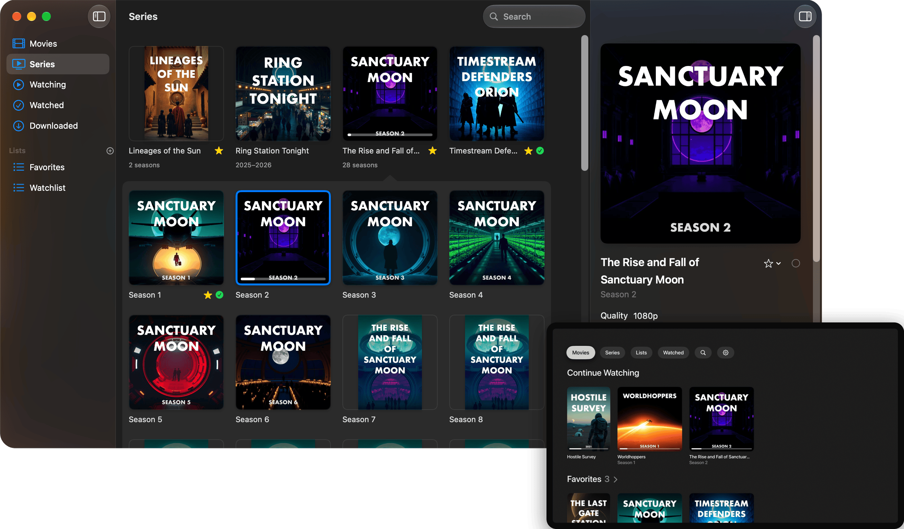
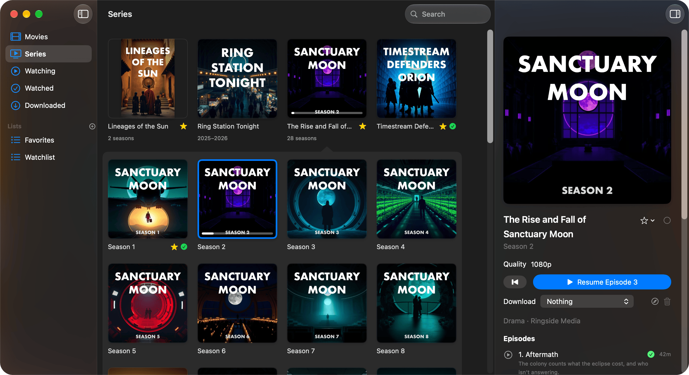
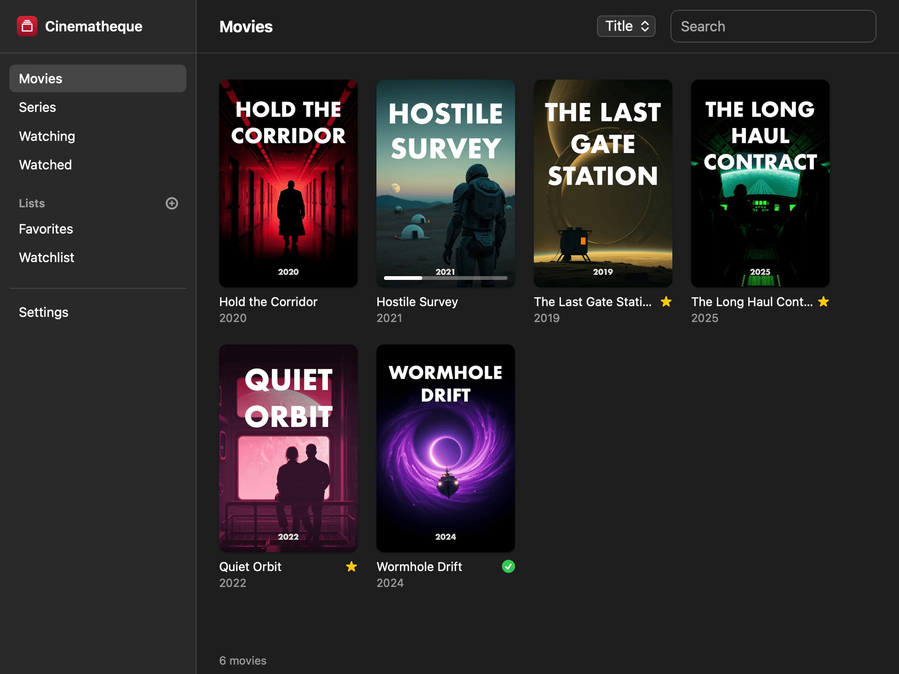

# Cinematheque

Cinematheque is a video library for your household. It catalogs the movies and TV shows on your own disks and NAS, and plays them on your devices straight from where they're kept. There's nothing to subscribe to or buy, and no account: the catalog is shared directly among your devices, and with the family and friends you invite.

> **Status:** early, at version 0.1 (see [Status](#status)).

<p align="center"><picture><source media="(prefers-color-scheme: light)" srcset="docs/screenshots/hero-light.png"></picture></p>

<table><tr>
<td align="center"><a href="docs/screenshots/mac-dark.png"><picture><source media="(prefers-color-scheme: light)" srcset="docs/screenshots/mac-light.png"></picture></a><br><sub>Mac</sub></td>
<td align="center"><a href="docs/screenshots/tv-dark.png"><picture><source media="(prefers-color-scheme: light)" srcset="docs/screenshots/tv-light.png"></picture></a><br><sub>Apple TV</sub></td>
<td align="center"><a href="docs/screenshots/iphone-dark.png"><picture><source media="(prefers-color-scheme: light)" srcset="docs/screenshots/iphone-light.png"></picture></a><br><sub>iPhone (a prototype)</sub></td>
<td align="center"><a href="docs/screenshots/web-dark.png"><picture><source media="(prefers-color-scheme: light)" srcset="docs/screenshots/web-light.png"></picture></a><br><sub>Web</sub></td>
</tr></table>

<sub>Shown on a made-up library.</sub>

## Status

Early, at version 0.1: expect rough edges, and changes between versions.

| | State |
| --- | --- |
| **Mac** (macOS 15+) | Released, not yet notarized: browsing, playing, lists, downloads, and Settings for sources, people, and devices |
| **Apple TV** (tvOS 18+) | Browsing, playing, lists, and Settings for people, devices, and servers; not released yet, so build it with Xcode |
| **iPhone** (iOS 18+) | A prototype: browsing, playing, lists, and Settings (people, devices, and servers); setting up is a stopgap, and nothing downloads yet |
| **Web client** | In the command-line app (`serve`): setup, browsing, playing, and settings, for a browser on the server's own computer (or every browser, with `--permissive`) |
| **Command-line app** | Released, for macOS and Linux |
| **Linux and Windows players** | Planned |

Planned beyond them: metadata from outside your files, a transcoder, and a list's own order; see [DEVELOPMENT.md](DEVELOPMENT.md).

## How it works

Every device keeps its own copy of the catalog, and of what you've watched, but not the videos. So each one browses offline, and catches up with the others when it can reach them. Stop a movie on the Mac, and the Apple TV resumes it where you left off:

<p align="center"></p>

<p align="center"></p>

* **Library:** the catalog: movies and series, their episodes and versions, and where each file is.
* **Source:** a folder or server holding your videos. Cinematheque only reads it, and never changes its files.
* **Quality:** one encoding of a title, such as 1080p or 4K HDR. A quality may have copies on several sources; when one doesn't load, players try the next.
* **Device:** anything running Cinematheque. Devices sync directly with each other, with no server in the middle.

## Getting it

* **The Mac app** and **the command-line app** (for macOS and Linux) are on the [releases page](https://github.com/idiomatic/Cinematheque/releases). They aren't notarized yet, so macOS asks before opening them the first time; the [guide](docs/guide.md#installing) says how, and what Linux needs.
* **The Apple TV and iPhone apps** aren't released yet; build them with Xcode (see [For developers](#for-developers)).

## Getting started

1. **Open the app** and create a library, or join one by the code it shows, from a device already in it.
2. **Add a source,** a folder or server of your videos: in the Mac's Settings › Sources, Add Folder… or Add Server…; the library fills in as it looks through it.

Or, on a computer that stays on (a Linux server, a NAS that runs Linux, or a Mac), share a folder with a web client to set it all up, then open `http://localhost:8008/` in a browser there:

```sh
cinematheque serve --media /srv/videos
```

## Using it

The [guide](docs/guide.md) covers it all:

* **[Sources](docs/guide.md#sources):** sharing a folder or adding a server, how to name files so titles are recognized ([Plex, Jellyfin, and Kodi's conventions](docs/guide.md#naming)), and [qualities](docs/guide.md#quality) side by side.
* **[Watching](docs/guide.md#watching):** resuming anywhere, covers from your own files, and lists.
* **[Downloading](docs/guide.md#downloading),** on a Mac, for away from home.
* **[Sharing a library](docs/guide.md#sharing-a-library)** with your other devices, and with family and friends.
* **[In a browser](docs/guide.md#in-a-browser),** from a computer that stays on.

## Privacy

Cinematheque has no accounts and no central server. Nothing leaves your devices but to the devices you sync with and the sources you add, and what you've watched syncs only directly among your own devices. It's kept from other people, not hardened against someone with access to a device that holds it.

## For developers

* **Building:** the Apple apps (Mac, Apple TV, iPhone) with Xcode 27 or later, as [apple/README.md](apple/README.md) says; the command-line app with Zig, as [cli/README.md](cli/README.md) says.
* **What's built:** [AGENTS.md](AGENTS.md) specifies it; [ARCHITECTURE.md](ARCHITECTURE.md) explains how devices write, sign, merge, and sync operations, and every key and field the library writes; [DEVELOPMENT.md](DEVELOPMENT.md) holds the plans, open questions, and known issues.
* **Components:** [core](core/README.md), the Zig library, and its [C interface](core/include/README.md); [cli](cli/README.md), the command-line app and its web client; [apple](apple/README.md), the Apple players; [tools](tools/README.md), scripts beside them, among them the [mock library](tools/README.md#a-mock-library) and the [screenshots](tools/README.md#screenshots) above.
* **Versions and releases:** major.minor from 0.1 (a third number for fixes), set once in [apple/Version.xcconfig](apple/Version.xcconfig). Each release is tagged (`v0.1`) and built by GitHub's [workflows](.github/workflows), its notes its [CHANGELOG.md](CHANGELOG.md) section.
* **Outside specifications:** [docs/specifications](docs/specifications/README.md) indexes the specifications and papers Cinematheque relies on; [docs/design](docs/design) holds sketches of the players.

## How it was made

Cinematheque was written with [Claude](https://claude.com).

## License

Cinematheque is licensed under the BSD 3-Clause License; see [LICENSE](LICENSE).
